<div align="center">

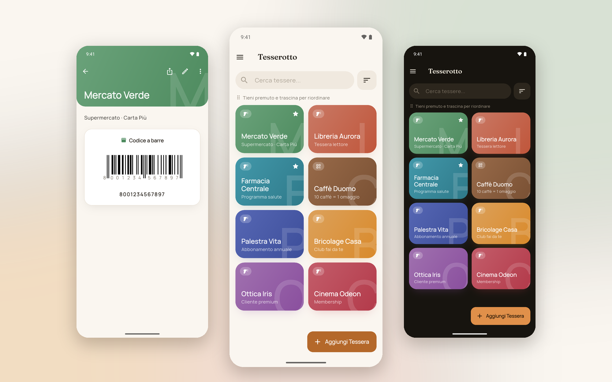

# Tesserotto

**Il wallet per carte fedeltà local-first, senza account e senza tracciamento.**

[](pubspec.yaml)
[](https://flutter.dev)
[](https://dart.dev)
[](#piattaforme-supportate)
[](https://riverpod.dev)
[](#persistenza)

[Sito](https://app.gabrieleportente.it) · [Funzionalità](#funzionalità) · [Screenshot](#screenshot) · [Architettura](#architettura) · [Per iniziare](#per-iniziare) · [Build e rilascio](#build-e-rilascio) · [Privacy](#sicurezza-e-privacy)

</div>

<table>
  <tr>
    <td align="center" width="50%">
      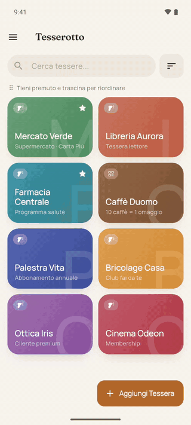<br>
      <sub><b>Apri, mostra alla cassa, cerca</b></sub>
    </td>
    <td align="center" width="50%">
      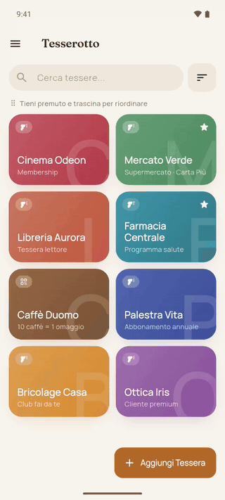<br>
      <sub><b>Ordinamento personalizzato con drag &amp; drop</b></sub>
    </td>
  </tr>
</table>

---

## Panoramica

Tesserotto è un'applicazione mobile Flutter per conservare e mostrare le carte fedeltà. Nasce come alternativa indipendente ai wallet commerciali (Stocard, ora confluito in Klarna) che hanno spostato le carte fedeltà dentro ecosistemi finanziari più ampi.

I principi del progetto:

| Principio | Come si traduce nel prodotto |
|---|---|
| **Local-first** | Le tessere vivono in un database SQLite nella sandbox dell'app. Nessun backend proprietario, nessun account obbligatorio. |
| **Zero tracciamento** | L'app non integra SDK di analytics, advertising o crash reporting. |
| **Backup sotto il controllo dell'utente** | Export JSON su file oppure backup facoltativo sul Google Drive personale, nella cartella privata dell'app. |
| **Veloce alla cassa** | Apertura in un tocco, luminosità massima automatica, widget sulla home del telefono. |

## Funzionalità

### Gestione tessere
- **Aggiunta guidata**: scansione con fotocamera, lettura del codice da un'immagine della galleria oppure inserimento manuale.
- **12 simbologie supportate**: EAN-13, EAN-8, UPC-A, Code 128, Code 39, Code 93, ITF, Codabar, QR Code, Aztec, Data Matrix, PDF417.
- **Personalizzazione**: nome, descrizione facoltativa e colore (palette predefinita o selettore libero).
- **Preferiti**: le tessere contrassegnate con la stella restano in evidenza.
- **Eliminazione con annullamento**: dopo la cancellazione uno snackbar permette di ripristinare la tessera. Dalle impostazioni si possono eliminare tutte le tessere in un'unica operazione.

### Consultazione
- **Griglia a schede** con gradiente nel colore della tessera e monogramma.
- **Ricerca istantanea** per nome e descrizione.
- **Tre ordinamenti**: alfabetico, più aperte, personalizzato con drag & drop. La scelta viene salvata.
- **Vista cassa**: codice a barre o QR ad alto contrasto anche in tema scuro, luminosità portata al massimo all'apertura e ripristinata all'uscita (disattivabile).

### Condivisione e interoperabilità
- **Link di importazione** (`https://app.gabrieleportente.it/import/…`) gestiti come Android App Links: chi riceve il link apre direttamente la schermata di importazione. Senza l'app installata, il link apre la pagina del [sito](https://app.gabrieleportente.it) con l'anteprima della tessera.
- **Condivisione via QR**: un QR contenente il link, da inquadrare con un altro telefono.
- **Formato compatto v1**: payload binario codificato in Base64URL ([dettagli](#formato-dei-link-di-condivisione)), con fallback JSON per i campi più lunghi.

### Backup
- **Export/Import JSON** tramite il selettore file di sistema.
- **Google Drive**: accesso con Google, backup e ripristino in un tocco. Con lo scope `drive.appdata` l'app vede solo la propria cartella nascosta e nessun altro file dell'utente.

### Integrazione con il sistema
- **Widget Android "Le più usate"**: le prime 5 tessere (prima i preferiti, poi per numero di aperture). Un tocco apre la tessera.
- **Tema chiaro, scuro o di sistema** con il design system "Soft & Warm".
- **Localizzazione** in italiano e inglese, selezionabile dalle impostazioni.
- **Feedback aptico, animazioni sfalsate e splash nativo** coerente con il tema.

## Screenshot

<table>
  <tr>
    <td align="center">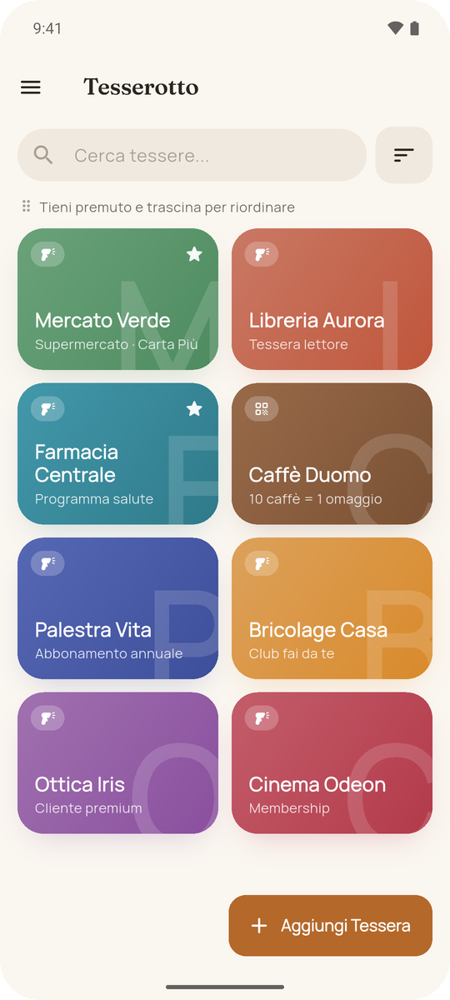<br><sub>Home</sub></td>
    <td align="center">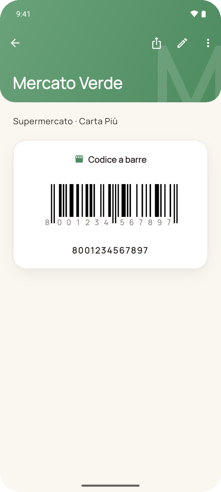<br><sub>Vista cassa</sub></td>
    <td align="center">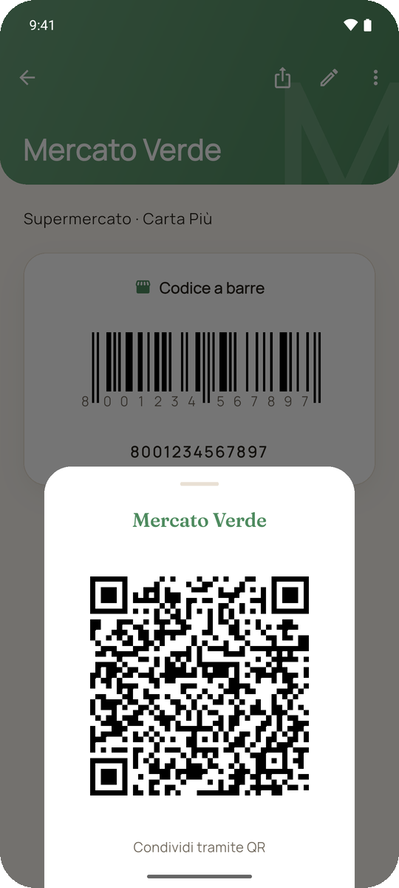<br><sub>Condivisione via QR</sub></td>
    <td align="center">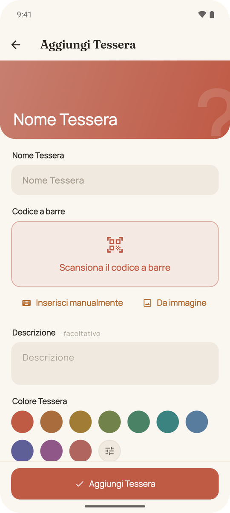<br><sub>Aggiunta tessera</sub></td>
  </tr>
  <tr>
    <td align="center">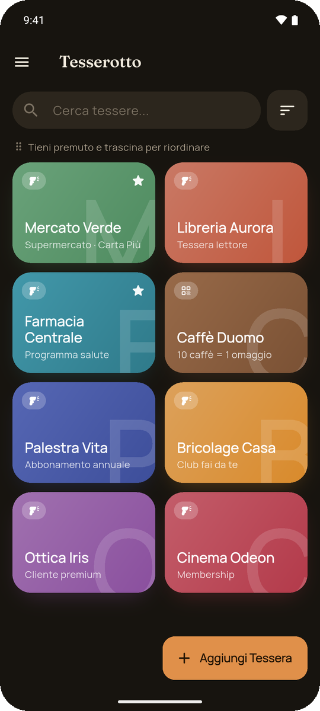<br><sub>Tema scuro</sub></td>
    <td align="center">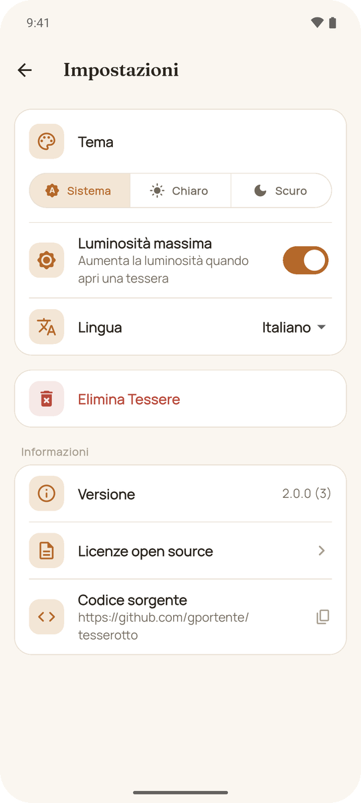<br><sub>Impostazioni</sub></td>
    <td align="center">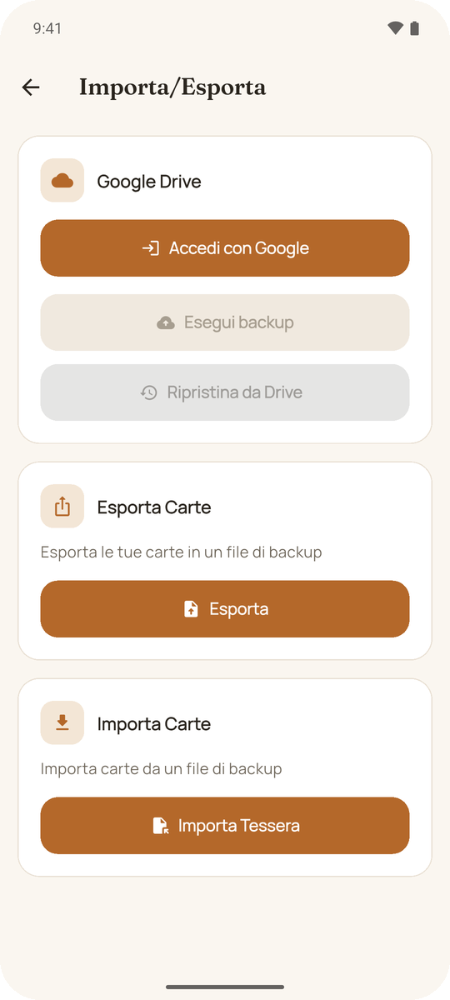<br><sub>Backup e Google Drive</sub></td>
    <td align="center">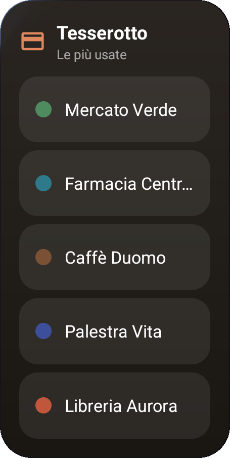<br><sub>Widget Android</sub></td>
  </tr>
</table>

> Le tessere negli screenshot sono dati dimostrativi: nomi di fantasia e codici generati.

## Architettura

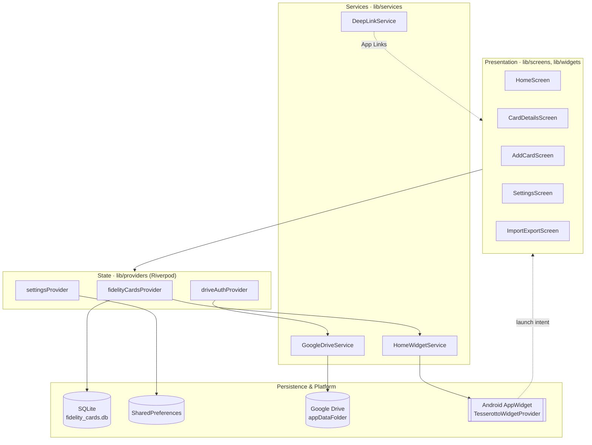

### Stack tecnologico

| Ambito | Tecnologia |
|---|---|
| Framework | Flutter (canale stable), Dart ≥ 3.0 |
| State management | `flutter_riverpod` |
| Persistenza | `sqflite` (tessere), `shared_preferences` (impostazioni) |
| Scansione e rendering codici | `mobile_scanner`, `barcode_widget`, `qr_flutter` |
| Cloud backup | `google_sign_in`, `googleapis` (Drive v3) |
| Widget home | `home_widget` + `AppWidgetProvider` nativo in Kotlin |
| Deep linking | `app_links` (Android App Links con `autoVerify` su `app.gabrieleportente.it`) |
| UI | Material 3, `google_fonts`, `reorderable_grid_view`, `flutter_svg` |
| Localizzazione | `flutter_localizations` + ARB (`gen-l10n`) |

### Persistenza

Le tessere sono salvate nella tabella `fidelity_cards` (schema versione 4). Le migrazioni sono incrementali e idempotenti: `onUpgrade` controlla le colonne esistenti prima di aggiungerle.

| Colonna | Tipo | Note |
|---|---|---|
| `id` | `TEXT` PK | UUID v4 |
| `name` | `TEXT` | obbligatorio |
| `description` | `TEXT` | facoltativo |
| `barcode` | `TEXT` | valore grezzo del codice |
| `barcodeType` | `TEXT` | una delle 12 simbologie supportate |
| `colorValue` | `INTEGER` | colore ARGB a 32 bit |
| `openCount` | `INTEGER` | alimenta l'ordinamento "più aperte" e il widget |
| `isFavorite` | `INTEGER` | 0/1 |
| `orderIndex` | `INTEGER` | posizione nell'ordinamento personalizzato |
| `created_at` | `TEXT` | ISO 8601 |

### Formato dei link di condivisione

Per tenere corti link e QR, la tessera viene serializzata in un formato binario versionato e poi codificata in Base64URL senza padding:

```
0x01 | flags | len(name) name | len(desc) desc | [len(barcode) barcode] | [barcodeType enum] | [ARGB uint32 BE]
         └─ bit0: barcode · bit1: barcodeType · bit2: colore
```

Se un campo supera i 255 byte UTF-8 si usa automaticamente il fallback JSON. Il decoder accetta entrambi i formati e anche quello legacy a chiavi brevi.

L'app accetta i link di `app.gabrieleportente.it` e, per compatibilità con quelli già condivisi, del vecchio dominio `app.auxrideum.ddns.ms`. La pagina web che apre i link e il file `assetlinks.json` vivono nel repository [tesserotto-website](https://github.com/gportente/tesserotto-website): il dominio va cambiato in entrambi i repository insieme.

### Struttura del repository

```
lib/
├── database/      # DatabaseHelper: connessione SQLite, schema, migrazioni, CRUD
├── l10n/          # File ARB (it, en) e classi generate
├── models/        # FidelityCard
├── providers/     # Riverpod: tessere, impostazioni, tema, Google Drive
├── screens/       # Home, dettaglio, aggiunta/modifica, impostazioni, import/export
├── services/      # Deep link, Google Drive, widget home
├── theme/         # Design system "Soft & Warm": palette e ThemeData
└── widgets/       # Componenti riutilizzabili (AnimatedCard, header, dialog, transizioni)
android/app/src/main/kotlin/…/TesserottoWidgetProvider.kt   # Widget nativo
docs/media/        # Immagini e GIF della documentazione
```

## Per iniziare

### Prerequisiti

- Flutter SDK, canale **stable** (sviluppato e testato con Flutter 3.44)
- Android Studio con Android SDK, oppure Xcode per iOS
- JDK 11 o superiore (toolchain Android: Gradle 8.14, AGP 8.11, Kotlin 2.2)

### Setup

```bash
git clone https://github.com/gportente/tesserotto.git
cd tesserotto
flutter pub get
flutter run
```

Le classi di localizzazione vengono generate durante la build (`flutter: generate: true`). Per rigenerarle a mano:

```bash
flutter gen-l10n
```

### Configurazione Google Drive (facoltativa)

Senza configurazione il backup su Drive non è disponibile; le altre funzioni restano utilizzabili. Per abilitarlo:

1. Crea un progetto in Google Cloud Console e abilita la **Google Drive API**.
2. Configura la schermata di consenso OAuth con lo scope `https://www.googleapis.com/auth/drive.appdata`.
3. Crea un client OAuth **Android** con package `com.gportente.tesserotto` e l'impronta SHA-1 del keystore che usi (debug e/o release).
4. Per iOS, crea un client OAuth **iOS** e aggiorna `GIDClientID` e lo URL scheme corrispondente in `ios/Runner/Info.plist`.

### Splash screen

La configurazione è in `pubspec.yaml` (sezione `flutter_native_splash`). Dopo una modifica:

```bash
dart run flutter_native_splash:create
```

## Build e rilascio

La firma release Android legge le credenziali da `android/key.properties`, che non va versionato:

```properties
storeFile=/percorso/assoluto/upload-keystore.jks
storePassword=********
keyAlias=upload
keyPassword=********
```

```bash
# APK release (minify abilitato)
flutter build apk --release

# Android App Bundle per il Play Store
flutter build appbundle --release

# iOS
flutter build ipa --release
```

La versione si gestisce in `pubspec.yaml` (`version: <name>+<build>`): `name` diventa `versionName` / `CFBundleShortVersionString`, `build` diventa `versionCode` / `CFBundleVersion`.

### Controlli di qualità

```bash
flutter analyze   # lint con flutter_lints
flutter test      # test di unità e widget
```

## Piattaforme supportate

| Piattaforma | Stato | Note |
|---|---|---|
| Android | ✅ Supportata | Tutte le funzionalità, compresi widget home e App Links |
| iOS | 🟡 Parziale | App completa; widget home non ancora disponibile |
| Web / Desktop | ⚪ Non supportate | Le cartelle sono quelle generate da Flutter e non vengono mantenute |

## Sicurezza e privacy

- **Nessun dato lascia il dispositivo** se l'utente non esporta un file, non condivide un link o non attiva il backup su Drive.
- **Accesso minimo a Drive**: lo scope `drive.appdata` limita l'app alla propria cartella nascosta; i file personali dell'utente restano inaccessibili.
- **L'app non integra SDK di analytics, pubblicità o profilazione.**
- **Permessi richiesti**: fotocamera (scansione), accesso alle immagini (lettura codice da galleria e import file), rete (solo per Drive).
- I link di condivisione contengono in chiaro (codificati, non cifrati) nome, descrizione, codice e colore della tessera: vanno trattati come il codice stesso.

## Roadmap

- [ ] Importazione da backup [Catima](https://catima.app) (stringhe di localizzazione già presenti)
- [ ] Widget home per iOS (WidgetKit)
- [ ] Suite di test automatici per database, provider e codec dei deep link
- [ ] Pipeline CI per analisi statica e build

## Contribuire

1. Crea un branch dal `master` (`feat/…`, `fix/…`, `chore/…`).
2. Usa messaggi di commit in stile [Conventional Commits](https://www.conventionalcommits.org/) (`feat(home): …`, `fix: …`).
3. Prima di aprire una pull request verifica che `flutter analyze` non riporti problemi.
4. Per le modifiche all'interfaccia, allega screenshot in tema chiaro e scuro.

---

<div align="center">
<sub>Tesserotto è un progetto indipendente, senza affiliazioni con Stocard, Klarna, Catima o altri marchi citati.</sub>
</div>
